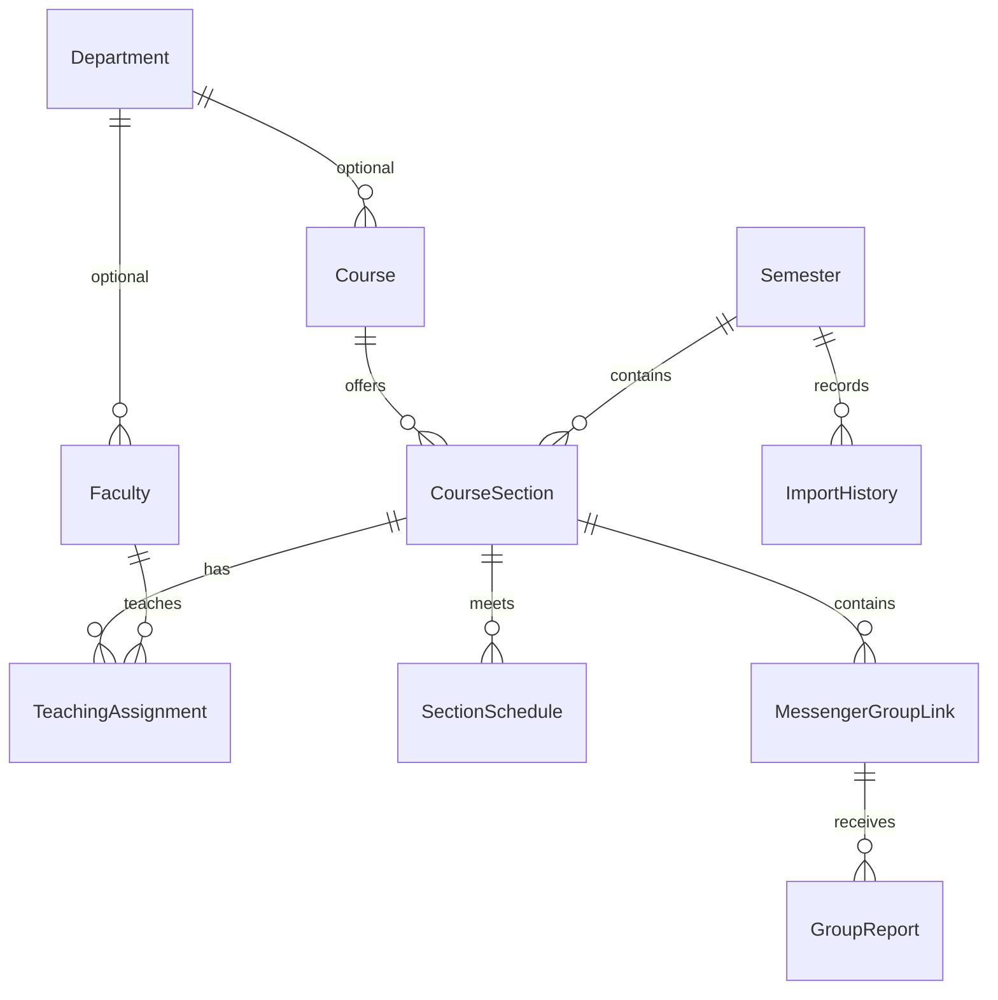

# Architecture

The project is one Next.js App Router application using strict TypeScript, React, Tailwind 4, shadcn-style Radix UI primitives, Lucide, Prisma 7, Supabase PostgreSQL, Auth, and Storage. Package versions are locked in `package-lock.json`; Prisma 8 was a release candidate at implementation time, so Prisma 7 is used as the stable compatible version.

Server Components load the catalog through a server-only Prisma repository. Client components manage immediate search, filters, progressive result display, inline course expansion, browser-local saved sections, form state, and dialogs. The `/saved` page reuses the homepage finder, with section IDs stored only in browser local storage. Pages are rendered dynamically so imports and new group links appear without stale catalog caches. React's `cache` deduplicates catalog reads within the request. The catalog deliberately has no cross-request cache. Public JSON writes use Route Handlers; administrator forms use Server Actions and revalidate directory paths.

The preview repository uses only the sanitized supplied source JSON and is selected only when `DATABASE_URL` is absent. A configured database error fails visibly and does not fall back to a fake catalog. The snapshot's `source` identifier marks the preview, and its semester label comes from the owner's explicit confirmation of Fall - 2026. Preview writes are disabled on both UI and server paths.

## Data model

Uniqueness: department code, faculty initials, course code, semester name, semester/course/section number, faculty/section assignment, section/day/time/room meeting, section/normalized invite. A partial unique index allows at most one active default semester. Checks enforce nonnegative seats, valid weekday/time ranges and meeting ordering, and canonical HTTPS group invites. Indexes support course/semester, faculty assignment, reports, and import chronology.

Safe deletion: courses/semesters with sections are restricted; assigned faculty must be unassigned before deletion; groups protect their sections; group reports are removed with a deliberately deleted group; section meetings/assignments cascade after a permitted section deletion. Optional department relations become null.

`AdminUser` stores a Supabase Auth UUID mapping with no public role-management endpoint. Bootstrap/revocation requires trusted database access. `ImportHistory` retains an admin UUID even if a mapping is later revoked. Trusted CLI imports can instead record the actual PostgreSQL session role with a null admin UUID. A database check requires exactly one of these identities, and web import actions still require administrator authentication. `RateLimitBucket` uses atomic SQL upsert for persistent counters, not per-process memory. `AppSettings` controls public notices and group submission availability.

## Write contracts

- `GET /api/challenge`: no-store signed short-lived form challenge; unavailable without a database.
- `POST /api/groups`: `{semesterId, courseId, sectionId, url, submitAnyway, website, token}`. Returns `{status:'created',id}` (201), `{status:'duplicate',id}` (200), or `{status:'warning',groups:[{id,url}]}` (200). Bad input returns an error (400), rate limits 429, missing database 503.
- `POST /api/reports`: `{groupId, reason, details, website, token}`. Creates a report after validation/rate limiting.
- Admin Server Actions: `saveRecord`, `deleteRecord`, `uploadPhoto`, `runImport`. Every entry point calls `requireAdmin`; entity strings are explicitly allowlisted. Every mutation uses a field-specific Zod schema and Prisma parameters.

Group transactions lock the actual section before querying existing invites. The unique constraint independently protects concurrent inserts. An invite warning never persists a link. Submit Anyway goes through the same validation and locks. Changes to a group-bearing section's identity are blocked so its invite cannot silently migrate to another class.

## Trust boundaries

The Supabase publishable key identifies the public project; it grants no directory table access. Database URLs, the optional Storage secret, and HMAC secret remain on the server. Auth uses Supabase-validated `getUser`, not an unverified cookie session. Admin authority comes from `AdminUser`, never user-editable metadata. The proxy refreshes Auth cookies on protected surfaces; it is not the sole authorization boundary.

Storage uploads use the secret client only after admin authorization and binary image re-encoding. The HTML parser uses Cheerio and never a browser. Public URLs use a narrow normalized allowlist. Rendered text is escaped by React. Public writes check Origin and JSON body size, and Server Actions also use Next.js's origin protections. Logs contain error kind/code rather than request bodies, database strings, or authentication tokens.

## Scale boundaries

The MVP loads one catalog per server request and filters it on the client. This is suitable for the supplied 496-section directory and keeps filter interactions immediate. For a large multi-year directory, move filtering/counts into paginated Prisma queries and fetch only selected-semester sections. The migration/test setup does not pretend to verify Supabase network reliability, connection limits, or production concurrency. Those require a configured staging project.
