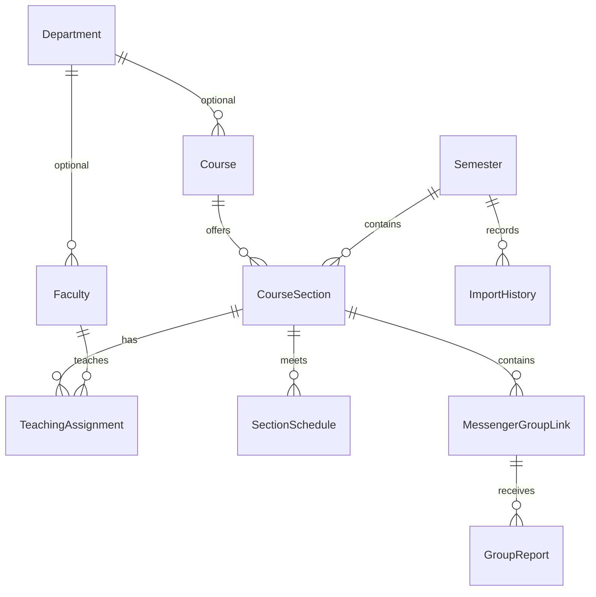

# Architecture

The project is one Next.js App Router application using strict TypeScript, React, Tailwind 4, shadcn-style Radix UI primitives, Lucide, Prisma 7, Supabase PostgreSQL, Auth, and Storage. Package versions are locked in `package-lock.json`; Prisma 8 was a release candidate at implementation time, so Prisma 7 is used as the stable compatible version.

Server Components load the public catalog through a server-only Prisma repository and Next's shared Data Cache. React's `cache` also deduplicates work within a render. Faculty profiles filter the same cached catalog on the server and serialize only relevant records, avoiding another SQL workload for each new faculty URL. Client components manage immediate search, filters, progressive result display, inline course expansion, browser-local saved sections, form state, and dialogs. The `/saved` page reuses the homepage finder, with section IDs stored only in browser local storage. Pages remain dynamically rendered; successful app writes immediately expire the shared public data and revalidate directory paths. Administrator views and security checks bypass the shared cache. Public JSON writes use Route Handlers; administrator forms use Server Actions. See [cache ownership and freshness](CACHING.md).

The preview repository uses only the sanitized supplied source JSON and is selected only when `DATABASE_URL` is absent. A configured database error fails visibly and does not fall back to a fake catalog. The snapshot's `source` identifier marks the preview, and its semester label comes from the owner's explicit confirmation of Fall - 2026. Preview writes are disabled on both UI and server paths.

## Data model

Uniqueness: department code, faculty initials, course code, semester name, semester/course/section number, faculty/section assignment, section/day/time/room meeting, section/normalized invite. A partial unique index allows at most one active default semester. Checks enforce nonnegative seats, valid weekday/time ranges and meeting ordering, and canonical HTTPS group invites. Indexes support course/semester, faculty assignment, reports, and import chronology.

Safe deletion: courses/semesters with sections are restricted; assigned faculty must be unassigned before deletion; groups protect their sections; group reports are removed with a deliberately deleted group; section meetings/assignments cascade after a permitted section deletion. Optional department relations become null.

`AdminUser` stores a Supabase Auth UUID mapping with no public role-management endpoint. Bootstrap/revocation requires trusted database access. `ImportHistory` retains an admin UUID even if a mapping is later revoked. Trusted CLI imports can instead record the actual PostgreSQL session role with a null admin UUID. A database check requires exactly one of these identities, and web import actions still require administrator authentication. `RateLimitBucket` uses atomic SQL upsert for persistent counters, not per-process memory. `AppSettings` controls public notices and group submission availability.

## Write contracts

- `GET /api/challenge`: no-store signed short-lived form challenge; unavailable without a database.
- `POST /api/groups`: `{semesterId, courseId, sectionId, url, submitAnyway, website, token}`. Returns `{status:'created',id}` (201), `{status:'duplicate',id}` (200), or `{status:'warning',groups:[{id,url}]}` (200). Bad input returns an error (400), rate limits 429, missing database 503.
- `POST /api/reports`: `{groupId, reason, details, website, token}`. Creates a report after validation/rate limiting.
- Admin Server Actions: `saveRecord`, `deleteRecord`, `uploadPhoto`, `runImport`. Every entry point calls `requireAdmin`; entity strings are explicitly allowlisted. Every mutation uses a field-specific Zod schema and Prisma parameters.

Group submissions and admin URL edits acquire a PostgreSQL transaction advisory lock keyed by the canonical invite, then lock the actual section. This serializes attempts to claim the same invite across sections, even across warm application instances; locks release at commit/rollback and work with transaction pooling. The global lookup checks canonical and legacy stored aliases across all semesters. A conflict returns HTTP 409 and a public section/semester warning. Submit Anyway cannot bypass it. The existing unique constraint independently protects same-section normalized duplicates. Multiple distinct invites within a section retain the existing warning/confirmation flow. Rejected submissions do not invalidate catalog caches. Changes to a group-bearing section's identity are blocked so its invite cannot silently migrate to another class. There is no new schema constraint or migration: direct database writes and older app deployments do not participate in this application protocol. Existing duplicates are left for manual review.

Before the ordinary rate limiter, invite expansion, or group queries, `/api/groups` checks the actor's ten-day submission ban. Allowed results are never cached locally; positive bans use a bounded 2,000-entry per-instance map until their fixed expiry. With optional Upstash REST credentials, shared Redis checks avoid PostgreSQL for banned requests even on cold instances. Otherwise `RateLimitBucket` persists bans and per-actor/per-canonical-invite counters. After expansion, the third attempt for the same invite within ten days atomically creates a ten-day ban before `saveGroup` runs. The first success and the two-step warning/confirmation count as attempts. SQL uses one parameterized CTE/upsert; Redis uses a single Lua script. Active ban expiry is never extended. Both stores use HMAC keys, not raw IPs or invite URLs. Redis outages/partial credentials fail closed with HTTP 503; stores are not silently interchanged. The HTTP 429 response includes `blockedUntil` and `Retry-After`; the form shows the expiry and disables resubmission. A network ban applies only to the group-submission API, not to public reads, reporting, or administrator operations. Local deny caching is an optimization, not the authority. Shared-IP users share the policy; this does not identify a person or prevent network-switching evasion. In-flight requests accepted before a ban can still finish; no multi-session production concurrency is claimed by local PGlite tests.

## Trust boundaries

The Supabase publishable key identifies the public project; it grants no directory table access. Database URLs, the optional Storage secret, and HMAC secret remain on the server. Auth uses Supabase-validated `getUser`, not an unverified cookie session. Admin authority comes from `AdminUser`, never user-editable metadata. The proxy refreshes Auth cookies on protected surfaces; it is not the sole authorization boundary.

Storage uploads use the secret client only after admin authorization and binary image re-encoding. The HTML parser uses Cheerio and never a browser. Public URLs use a narrow normalized allowlist. Rendered text is escaped by React. Public writes check Origin and JSON body size, and Server Actions also use Next.js's origin protections. Logs contain error kind/code rather than request bodies, database strings, or authentication tokens.

## Scale boundaries

The Prisma client is reused per process with a bounded five-connection `pg` pool. Vercel registers lifecycle cleanup and normalizes Supabase session-pooler runtime URLs to transaction mode. Migration URLs are independent and never rewritten.

The MVP shares one cached catalog across public requests and filters directory results on the client. Concurrent cold reads in a warm instance share SQL work, with a revision check when a local mutation overlaps a read. A five-minute revalidation interval provides a fallback for external SQL/CLI changes; app writes expire the cache immediately. This is suitable for the supplied 496-section directory and keeps filter interactions immediate. For a large multi-year directory, move filtering/counts into paginated Prisma queries and fetch only selected-semester sections. The migration/test setup does not pretend to verify Supabase network reliability, connection limits, or production concurrency. Those require a configured staging project. Vercel functions use Singapore (`sin1`) to match the supplied database endpoint.
